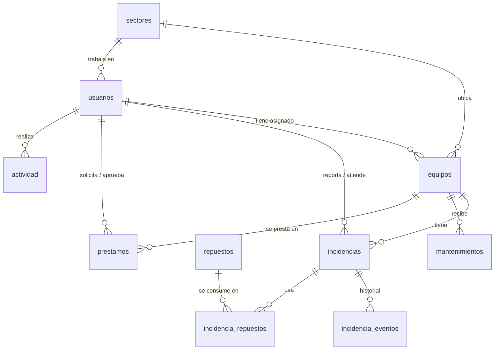

# FIRULAIS · Gestión IT

Sistema web del área de Sistemas de **FIRULAIS SRL** (Trabajo Final 2026, punto 17). Lleva el inventario de los
equipos del edificio nuevo por planta y oficina, las fallas que reportan los empleados, el mantenimiento preventivo
(punto 4), los préstamos de equipos del depósito y el stock de repuestos (punto 6).

Los datos de ejemplo salen del proyecto: los 33 sectores y las 86 bocas de red del plano de AutoCAD
(73 PCs + 13 impresoras en 4 plantas) y los 9 servidores del presupuesto.

## Qué puede hacer cada usuario

| Rol | Puede |
|---|---|
| **Empleado** | Ver sus equipos, reportar fallas y seguir su estado, comentar, pedir y cancelar préstamos |
| **Técnico** | Todo lo anterior + inventario completo, tomar/asignar/resolver incidencias, usar repuestos, registrar mantenimientos, entregar y recibir préstamos, ajustar stock, exportar planillas Excel |
| **Administrador** | Todo lo anterior + alta, edición y bloqueo de usuarios |

Usuarios de ejemplo (contraseña `firulais2026`): `admin@firulais.com.ar`, `tecnico@firulais.com.ar`,
`empleado@firulais.com.ar`. **Cambiá estas contraseñas antes de usarlo en serio.**

## Arquitectura (MVC)

```
backend/                 PHP 8.3+ sin frameworks, mismo esquema que el CRUD MVC de la cátedra
├── public/              ÚNICA carpeta pública: la app compilada + api/index.php
│   └── api/index.php    Front Controller: rutas → controlador, sesión, errores en JSON
├── config/config.php    Datos de conexión (variables de entorno o valores de XAMPP)
├── core/                Database (PDO Singleton), Router, Auth (sesión, roles, CSRF), Validator, Model
├── models/              Modelo: consultas SQL y reglas de negocio (transacciones)
├── controllers/         Controlador: valida la entrada, controla permisos, llama al modelo
└── database/            schema.sql (estructura) y seed.sql (datos de FIRULAIS)
src/                     Vista: React (pantallas, componentes, estilos)
tests/                   api.test.sh, e2e/flujos.mjs, e2e/accesibilidad.mjs
deploy/                  Configuración de NGINX y guía de instalación
```

Una petición: el navegador llama a `/api/incidencias` → `api/index.php` (front controller) → `Router` →
`IncidenciasController::store()` valida y controla el rol → `IncidenciaModel::create()` guarda en MariaDB dentro de
una transacción → respuesta JSON → la vista React la muestra.

**Reglas que garantiza el servidor:** un equipo no se presta dos veces; el stock de repuestos nunca queda negativo;
una incidencia en reparación pone el equipo "en reparación" y al resolverse vuelve a operativo; registrar un
mantenimiento calcula el próximo (6 meses PCs/impresoras, 3 meses servidores/red); un empleado solo ve lo suyo.

**Seguridad:** contraseñas con `password_hash`, sesión con cookie HttpOnly/SameSite, token CSRF en cada cambio,
consultas preparadas (PDO), validación de todos los datos, bloqueo de 10 minutos tras 5 intentos fallidos.

### Base de datos



## Instalación

- **XAMPP (Windows)** y **Ubuntu Server con NGINX + PHP-FPM + MariaDB**: ver [deploy/GUIA.md](deploy/GUIA.md).
  La app ya compilada está en `backend/public/`, así que para instalarla no hace falta Node.js.

## Desarrollo

Requisitos: Node 20+, PHP 8.3+ con `pdo_mysql`, MariaDB/MySQL, Python 3 (solo para regenerar los datos).

```bash
npm install
npm run db start          # MariaDB del usuario en .dev/ (puerto 3307), sin sudo
npm run db reset          # crea la base y carga los datos de FIRULAIS
npm run api               # API en http://127.0.0.1:8000 (sirve también la app compilada)
npm run dev               # app con recarga en vivo: http://localhost:5173
```

| Comando | Qué hace |
|---|---|
| `npm run build` | Compila la app dentro de `backend/public/` |
| `npm run test:api` | 53 pruebas de la API: permisos, validaciones y reglas de negocio |
| `npm run test:e2e` | 27 pasos en el navegador con los tres roles (falla → repuesto → resolución, préstamo, mantenimiento, Excel) |
| `npm run test:a11y` | Auditoría de accesibilidad WCAG 2.1 AA en todas las pantallas, tema claro y oscuro |
| `npm run seed` | Regenera `seed.sql` (las fechas quedan relativas al día en que se carga) |

Las pruebas recargan la base de desarrollo antes y después. Para correrlas contra otro servidor:
`tests/api.test.sh http://servidor/api` y `node tests/e2e/flujos.mjs http://servidor/`.
