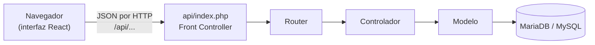
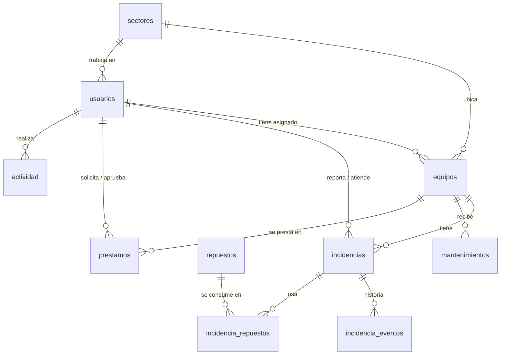

# Cómo está hecha la app

FIRULAIS · Gestión IT es el sistema web del área de Sistemas de FIRULAIS SRL (Trabajo Final 2026, punto 17).
Este documento explica cómo está construida, cómo se reparten los permisos entre los roles y de qué partes se
compone. Para usarla, ver el [Manual de uso](MANUAL.md).

## Vista general



La app está separada en dos partes que se comunican solo por la API:

| Parte | Tecnología | Qué hace |
|---|---|---|
| **Backend** (`backend/`) | PHP 8.3+ sin frameworks, patrón **MVC** | Recibe cada pedido, controla la sesión y el rol, valida los datos, aplica las reglas de negocio y lee/escribe la base. Devuelve siempre JSON. |
| **Base de datos** | MariaDB o MySQL (InnoDB, `utf8mb4`) | Guarda equipos, usuarios, incidencias, mantenimientos, préstamos, repuestos y el registro de actividad. |
| **Frontend** (`src/`) | React 19 + Vite | Es la **Vista** del MVC: las pantallas que usa la gente. No guarda datos propios; todo lo pide a la API. |

Al compilar (`npm run build`) la interfaz queda dentro de `backend/public/`. Por eso para instalar el sistema
alcanza con copiar la carpeta `backend/` al servidor (XAMPP o NGINX); no hace falta Node.js en producción.

## Cómo viaja un pedido

Ejemplo: un empleado reporta que su PC no enciende.

1. En la pantalla **Reportar falla** completa el formulario y toca **Enviar reporte**. React envía
   `POST /api/incidencias` con los datos en JSON, la cookie de sesión y el token CSRF.
2. **`backend/public/api/index.php`** (Front Controller) es el único punto de entrada: arranca la sesión, carga las
   clases y le pasa el pedido al `Router`.
3. **`core/Router.php`** busca la ruta, verifica que haya sesión, que el rol tenga permiso y que el token CSRF sea
   correcto. Si algo falla responde `401`, `403` o `419` sin llegar al controlador.
4. **`controllers/IncidenciasController.php`** valida cada campo con `core/Validator.php` (obligatorio, largo
   máximo, valores permitidos…).
5. **`models/IncidenciaModel.php`** comprueba que el equipo exista, guarda la incidencia con una consulta preparada
   (PDO), agrega el primer evento al historial y registra la actividad, todo dentro de una **transacción**.
6. La respuesta vuelve como JSON (`201`) y la interfaz muestra el aviso «Falla reportada» con el número de
   seguimiento.

Si hay un error de datos, la API responde `422` con el mensaje de cada campo y el formulario lo muestra debajo del
campo correspondiente. Los errores internos nunca muestran detalles técnicos al usuario.

## Roles y permisos

Hay tres roles. Cada usuario tiene uno solo, y lo asigna el administrador.

| Puede… | Empleado | Técnico | Administrador |
|---|:---:|:---:|:---:|
| Entrar y ver su panel | ✔ | ✔ | ✔ |
| Ver **sus** equipos (los asignados a él) | ✔ | ✔ | ✔ |
| Ver **todo** el inventario, filtrar y exportar a Excel | | ✔ | ✔ |
| Dar de alta, editar y dar de baja equipos | | ✔ | ✔ |
| Reportar una falla (la pantalla le ofrece sus equipos y los compartidos de su sector) | ✔ | ✔ | ✔ |
| Ver y comentar **sus** incidencias | ✔ | ✔ | ✔ |
| Ver todas las incidencias, asignarlas, cambiar prioridad y estado, resolverlas | | ✔ | ✔ |
| Registrar repuestos usados en una reparación | | ✔ | ✔ |
| Ver el plan de mantenimiento, registrar mantenimientos y exportar la planilla | | ✔ | ✔ |
| Pedir un préstamo y cancelar su pedido pendiente | ✔ | ✔ | ✔ |
| Entregar, rechazar y recibir devoluciones de préstamos | | ✔ | ✔ |
| Ver el stock de repuestos, cargar repuestos y ajustar stock | | ✔ | ✔ |
| Crear usuarios, cambiar roles, contraseñas y bloquear el acceso | | | ✔ |

Los permisos se controlan **en el servidor**, no solo en la pantalla. Cada ruta de `backend/public/api/index.php`
declara qué roles la pueden usar:

```php
$router->add('GET',  '/incidencias',      [IncidenciasController::class, 'index']);          // cualquier usuario logueado
$router->add('PUT',  '/incidencias/{id}', [IncidenciasController::class, 'update'], $staff); // técnico o admin
$router->add('POST', '/usuarios',         [UsuariosController::class, 'store'], ['admin']);  // solo admin
```

Además, en las rutas que comparten todos los roles, el controlador filtra lo que ve cada uno: un empleado que pide
`GET /api/incidencias` recibe solo las que reportó él, y si intenta abrir la de otro recibe `403`. La interfaz
oculta los menús y botones que el rol no puede usar, pero aunque alguien llamara a la API a mano, el servidor lo
rechaza.

Protecciones del administrador: no puede quitarse a sí mismo el rol de administrador ni bloquear su propia cuenta,
para que el sistema nunca quede sin nadie que lo administre.

## Cómo está compuesta

### Backend (MVC en PHP)

```
backend/
├── public/                  ÚNICA carpeta accesible desde la web
│   ├── index.html, assets/  la interfaz React ya compilada
│   └── api/index.php        Front Controller: todas las rutas de la API
├── config/config.php        conexión a la base (variables de entorno o valores de XAMPP)
├── core/                    piezas comunes del framework propio
│   ├── Database.php         conexión PDO única (Singleton) y transacciones
│   ├── Router.php           rutas, control de rol y de token CSRF
│   ├── Auth.php             login, sesión, roles, bloqueo por intentos fallidos
│   ├── Validator.php        reglas de validación de los datos recibidos
│   ├── Http.php             lectura del pedido, respuestas JSON y errores
│   └── Model.php            base de los modelos: consultas preparadas, alta, edición
├── models/                  MODELO: SQL y reglas de negocio
├── controllers/             CONTROLADOR: valida, controla permisos y llama al modelo
└── database/                schema.sql (estructura) y seed.sql (datos de FIRULAIS)
```

| Módulo | Controlador | Modelo | Reglas importantes |
|---|---|---|---|
| Sesión | `AuthController` | `UsuarioModel` | 5 intentos fallidos bloquean la cuenta 10 minutos |
| Panel | `DashboardController` | `DashboardModel` | Datos distintos para personal de Sistemas y para empleados |
| Equipos | `EquiposController` | `EquipoModel` | Código único; el empleado solo ve los suyos |
| Incidencias | `IncidenciasController` | `IncidenciaModel` | Estados y efectos sobre el equipo (ver abajo) |
| Mantenimiento | `MantenimientosController` | `MantenimientoModel` | Calcula el próximo mantenimiento |
| Préstamos | `PrestamosController` | `PrestamoModel` | Un equipo no se presta dos veces |
| Repuestos | `RepuestosController` | `RepuestoModel` | El stock nunca queda negativo |
| Usuarios | `UsuariosController` | `UsuarioModel` | Email único; contraseña de 8 caracteres o más |
| Sectores | `SectoresController` | `SectorModel` | Los 33 sectores del plano, por planta |

### Reglas de negocio que garantiza el servidor

- **Incidencias.** Pasan por los estados *Abierta → En reparación / Esperando repuesto → Resuelta → Cerrada*. Para
  salir de *Abierta* tiene que haber un técnico asignado; para resolverla hay que escribir la solución aplicada.
  Mientras está en reparación el equipo figura **en reparación**; al resolverse vuelve a **operativo**. Una
  incidencia cerrada ya no se modifica.
- **Repuestos.** Al registrar un repuesto en una incidencia se descuenta del stock en la misma transacción, con la
  fila bloqueada (`SELECT … FOR UPDATE`): si no alcanza, no se descuenta nada. La base además tiene la restricción
  `CHECK (stock >= 0)`. Los ajustes manuales piden motivo y quedan registrados.
- **Préstamos.** Solo se prestan equipos marcados como prestables que estén en el depósito. Al entregarlo el equipo
  pasa a **en préstamo** y al devolverlo vuelve al **depósito**. Si dos técnicos intentan entregar el mismo equipo a
  la vez, el bloqueo de fila hace que el segundo reciba un aviso en lugar de duplicar el préstamo. Un préstamo activo
  con la fecha de devolución vencida se muestra como **Demorado**.
- **Mantenimiento (punto 4).** Registrar un mantenimiento actualiza en el equipo la fecha del último y calcula el
  próximo: **6 meses** para PCs, notebooks, impresoras y periféricos; **3 meses** para servidores y equipos de red.
  No se aceptan fechas futuras.

### Base de datos



| Tabla | Guarda |
|---|---|
| `sectores` | Las 33 oficinas del edificio, con su planta (0 a 3) y bocas de red |
| `usuarios` | Nombre, email, contraseña cifrada, rol, sector y si está activo |
| `equipos` | Código, tipo, marca, modelo, serie, IP, año de fabricación, sector, a quién está asignado, estado, si es prestable y fechas de último y próximo mantenimiento |
| `incidencias` | Equipo, quién la reportó, técnico asignado, parte que falla, prioridad, estado, descripción y solución |
| `incidencia_eventos` | Historial de cada incidencia: comentarios y cambios de estado |
| `repuestos` | Nombre, categoría, compatibilidad, stock, stock mínimo y ubicación |
| `incidencia_repuestos` | Qué repuestos se usaron en cada reparación |
| `mantenimientos` | Fecha, tipo (preventivo/correctivo), tareas, técnico y próximo mantenimiento |
| `prestamos` | Equipo, solicitante, quién lo entregó, motivo, destino, fechas y estado |
| `actividad` | Registro de quién hizo qué y cuándo (se ve en el panel) |

Los datos de ejemplo (`seed.sql`) salen del proyecto: 33 sectores y 86 bocas de red del plano (73 PCs y 13
impresoras en 4 plantas), los 9 servidores del presupuesto, switches, router, access points, notebooks y
proyectores del depósito, 77 usuarios, 17 repuestos, incidencias y préstamos. Las fechas se calculan respecto del
día en que se carga la base, así la demo siempre se ve actual. Se regeneran con `npm run seed`
(`tools/gen_seed.py`).

### Frontend (la Vista)

```
src/
├── main.jsx, App.jsx        arranque, tema guardado y rutas de cada pantalla (protegidas por rol)
├── auth.jsx                 sesión del usuario y su rol, disponible para toda la app
├── lib/                     api.js (llamadas a la API con CSRF), useResource, useForm, formatos, textos, exportar a Excel
├── components/              AppShell (menú lateral, barra superior), tablas, ventanas, avisos, botones y campos
├── pages/                   una carpeta o archivo por pantalla: Panel, Equipos, Incidencias, Mantenimiento, Préstamos, Repuestos, Usuarios
└── styles/                  tokens.css (colores y medidas, tema oscuro y claro) y app.css
```

- Las direcciones usan `#` (`/#/equipos`), así la misma app funciona en una subcarpeta de XAMPP o en la raíz de
  NGINX sin configuración extra.
- La exportación a Excel (`.xlsx`) se genera en el navegador con SheetJS; la librería se descarga solo cuando
  alguien exporta.
- El diseño parte del Figma APP-DAI (azul marino y cian) con tema oscuro y claro, y se adapta a celular, tablet y
  computadora.

## Seguridad

- Contraseñas guardadas con `password_hash` (bcrypt), nunca en texto plano.
- Sesión con cookie `HttpOnly` y `SameSite`; el identificador de sesión se renueva al iniciar sesión. Con HTTPS, la
  cookie se marca como segura automáticamente.
- Token **CSRF** obligatorio en todo pedido que modifica datos.
- Todas las consultas son **preparadas** (PDO): no hay SQL armado con texto del usuario.
- Validación de todos los datos que llegan, en el servidor.
- Bloqueo de 10 minutos después de 5 intentos de login fallidos.
- Solo `backend/public/` es accesible desde la web; la configuración, los modelos y los `.sql` quedan fuera.

## Pruebas

| Comando | Qué prueba |
|---|---|
| `npm run test:api` | 53 pruebas de la API: permisos por rol, validaciones y reglas de negocio |
| `npm run test:e2e` | 27 pasos en un navegador real con los tres roles: falla → repuesto → resolución, préstamo, mantenimiento, Excel |
| `npm run test:a11y` | Accesibilidad WCAG 2.1 AA de todas las pantallas, en tema claro y oscuro |

Las pruebas recargan la base de datos: usarlas solo en el entorno de desarrollo o de prueba.

## Instalación

- Desarrollo y comandos: [README](../README.md).
- XAMPP (punto 17) y Ubuntu Server con NGINX + PHP-FPM (punto 15): [deploy/GUIA.md](../deploy/GUIA.md).
